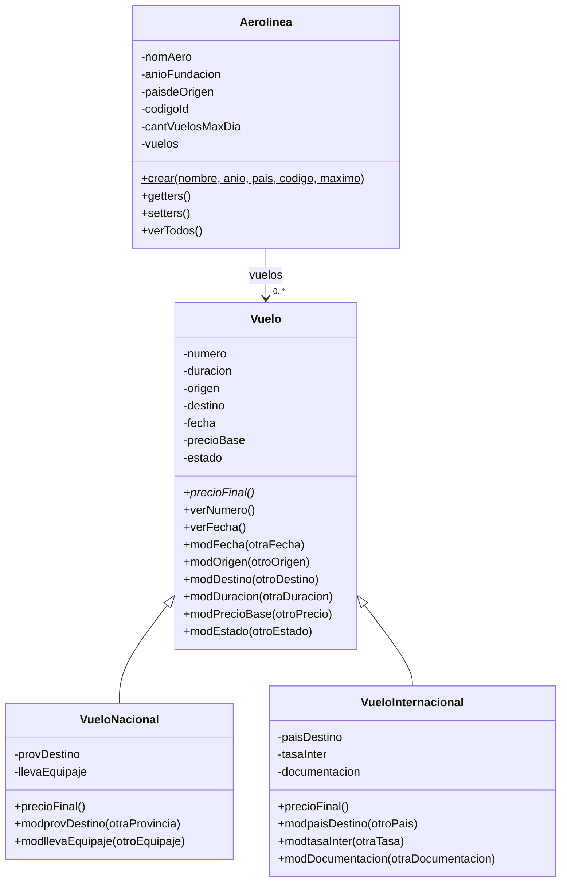

# Diagrama de clases de la aerolinea

Version del **17/10/2026**, correspondiente al modelo de dominio de `desarrollo/`. Fuentes: [enunciado 1, p. 2](../enunciado/Trabajo%20Integrador%20-%20Enunciados%202026.pdf), [pautas, p. 2](../enunciado/Trabajo%20Integrador%20-%20Pautas%202026.pdf) y [UML, pp. 5-9](../../teoria/material/4-POO-UML.pdf). El menu y la logica de negocio se ejecutan en el Workspace `AplicacionAerolinea.st`; no hay una clase de aplicacion en el modelo.

El nombre `modificarFechaDeVuelo_a` representa el selector Smalltalk `modificarFechaDeVuelo:a:`. El asterisco en `Vuelo>>precioFinal` indica el contrato que deben implementar las subclases; la version base envia `subclassResponsibility`. Dolphin permite crear un `Vuelo` base, pero el menu construye los dos tipos concretos.

La asociacion de vuelos usa una misma coleccion con varias fechas y todos los estados. El Workspace controla el maximo diario y mantiene fijo el numero al editar. Nacional calcula precio base mas 10% si incluye equipaje; Internacional suma la tasa.

La aplicacion identifica subtipos mediante `isKindOf:`, heredado de Object, siguiendo Mensajes y control, p. 21, y el ejemplo local de Biblioteca. El usuario eligio esta alternativa y se retiro el metodo auxiliar `verTipo`; no se incorpora un atributo de tipo.

El criterio de disponibles se mantiene segun la decision provisional del usuario. Este diagrama representa solo las clases de dominio; los bloques del Workspace no son clases del modelo.
