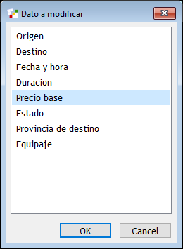
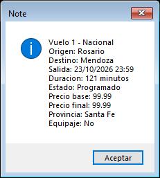
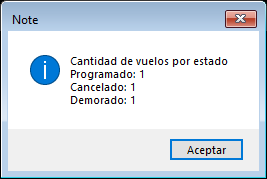

# Validacion del menu con dialogos reales

## Workspace actual

**17/10/2026 — Dolphin Smalltalk Professional 7.0.5, copia temporal de `DPRO.img7`, no guardada.**

Se hizo File In, en este orden, de `Vuelo.cls`, `VueloNacional.cls`, `VueloInternacional.cls` y `Aerolinea.cls`. No se importaron `AplicacionAerolinea.cls` ni los archivos `*Metodos.txt`. Luego se abrio `AplicacionAerolinea.st` en un Workspace, se selecciono todo y se evaluo con Ctrl+E.

La primera evaluacion no mostro el menu porque el Workspace tenia delimitadores desbalanceados. Dolphin marco el token `opcion` posterior al cierre incorrecto; al intentar evaluar mediante el comando de menu sin foco en el texto tambien se observo el error independiente `UndefinedObject does not understand #first`. Este ultimo correspondio al mecanismo de automatizacion, no al codigo evaluado. Se corrigieron los cierres de las opciones 1, 3, 4, 5, 6 y 7. La evaluacion posterior mostro `Gestion de aerolinea` y permitio completar el recorrido.

Resultados observados en la ejecucion corregida:

| Recorrido del Workspace | Resultado observado |
| --- | --- |
| Salir y cancelar el selector principal | Ambos finalizaron el ciclo sin error |
| Cancelar cada uno de los cinco campos de la aerolinea | No quedo una aerolinea parcial; la opcion de datos siguio informando que primero debia cargarse |
| Entradas invalidas de texto y enteros | Se rechazaron vacio, letras y valores inferiores al minimo; luego se aceptaron los valores validos |
| Carga nacional 101 | Sin equipaje; `precioFinal = 100` |
| Carga internacional 202 | Tasa 50 y documentacion `false`; `precioFinal = 250` |
| Numero 101 repetido | Rechazado antes de solicitar los demas datos |
| Tercer vuelo el 20/10/2026, con maximo diario 2 | Rechazado; un vuelo del 21/10 fue aceptado |
| Cupo diario | Ignoro la hora y conto Programado, Demorado, Cancelado y Finalizado |
| Busqueda | Mostro ambos subtipos y sus particulares; 999 informo inexistencia |
| Edicion | Campos comunes y particulares actualizados, numero y subtipo conservados |
| Fecha hacia el 21/10 ya completo | Rechazada y conservada `20/10/2026 10:00` |
| Solo hora, `20/10/2026 15:30` | Aceptada porque el propio vuelo no se conto dos veces |
| Cancelaciones de carga y edicion | No publicaron ni modificaron datos parciales |
| Elegir No | Guardo `false` en equipaje y documentacion; no se interpreto como cancelacion |
| Nueve consultas con datos | Todos=4; Programados=101; menor a 2 h=101/305; destino Mendoza=101; promedio=212.875; superior=202; mayor duracion=202; facturacion=150.5; un vuelo en cada estado |
| Baja individual | Se elimino 305 y quedaron 3 vuelos |
| Baja de cancelados | Informo 1 eliminado y quedaron solamente 101 y 202 |
| Nueve consultas con coleccion vacia | Listados y mayor/diccionario informaron ausencia; promedio y facturacion devolvieron 0 |

La comprobacion final dentro de la misma imagen informo `AplicacionAerolinea=false MenuAerolinea=false`. Por lo tanto, el recorrido no necesito ni creo esas clases. Los constructores, accesores y `precioFinal` de `VueloNacional` y `VueloInternacional` fueron ejercitados por el menu y conservaron los resultados esperados. La copia temporal se cerro sin guardar.

## Validacion historica de la arquitectura anterior

Los resultados que siguen corresponden a la version anterior, implementada en la clase `AplicacionAerolinea`. El usuario luego pidio retirar esa clase y mover la interfaz y la logica al Workspace `desarrollo/AplicacionAerolinea.st`. Por lo tanto, estas pruebas son antecedentes de comportamiento y **no validan por si mismas el Workspace actual**; su nueva ejecucion esta documentada en la seccion anterior.

**17/10/2026 — Dolphin Professional 7.0, imagen temporal aislada.**

La version integrada completo un recorrido automatizado sobre los dialogos reales de `ChoicePrompter`, `Prompter` y `MessageBox`, usando clics y entrada de caracteres. Se registraron **184 acciones/comprobaciones y una verificacion final**, con salida **0**. Las cinco clases del repo coinciden con las copias utilizadas en esta ejecucion.

Esta comprobacion complementa los **46 casos/escenarios automatizados** ya documentados en [la guia del menu](menuDolphinHelper.md). No reemplaza la revision del equipo ni confirma criterios docentes provisionales.

Tras la revision del usuario se recupero la aplicacion completa desde la copia guardada de las pruebas y se reemplazo `verTipo` por **`isKindOf:`**, siguiendo Mensajes y control, p. 21, y Biblioteca. Se repitieron los 46 casos/escenarios, la actualizacion conservando objetos existentes y este recorrido completo, con salida 0. Las capturas y el registro enlazados corresponden a esa version actualizada. El archivo encontrado con el menu inicial quedo respaldado localmente; no se pudo establecer la causa de su reemplazo.

## Comprobaciones

| Recorrido | Resultado observado |
| --- | --- |
| Operar sin aerolinea | Aviso y vuelta al menu |
| Cargar aerolinea y ambos subtipos | Datos comunes y particulares conservados; importes decimales aceptados |
| Ingresar 31/02/2026 | Rechazo y nueva solicitud de fecha |
| Repetir numero o superar cupo diario | Rechazo sin agregar el vuelo |
| Cancelar una carga, una edicion o una consulta | Vuelta al menu sin aplicar la operacion cancelada |
| Mover el vuelo 1 al 22/10, ya completo con dos vuelos | Rechazo; busqueda posterior muestra su fecha original del 21/10 |
| Cambiar solo la hora del vuelo 1 y trasladarlo luego al 23/10 | Cambios aceptados; numero conservado |
| Ingresar 120.555 al editar precio | Rechazo; posterior ingreso de 99.99 aceptado |
| Editar campos comunes y particulares | Origen, destino, fecha/hora, duracion, precio, provincia, equipaje, pais, tasa y documentacion actualizados |
| Elegir No en equipaje o documentacion | Se guarda `false`, sin tratarlo como cancelacion |
| Ejecutar las nueve consultas | Resultados esperados y exclusiones comprobados |
| Buscar un numero inexistente | Aviso; sin modificar otros vuelos |
| Eliminar un vuelo y luego todos los cancelados | Queda solo el vuelo vigente |
| Salir y reabrir la misma aplicacion | Misma aerolinea, coleccion y vuelo; datos conservados |
| Cancelar el menu principal | Finalizacion correcta |

En el conjunto de consultas, el vuelo Programado tiene precio final **99.99**, el Demorado **112.59** y el Cancelado **220**. El promedio observado es **106.29**, el listado superior muestra solo el Demorado y la facturacion potencial es **99.99**. El diccionario muestra un vuelo de cada uno de esos tres estados antes de las bajas.

La comprobacion final dentro de Dolphin verifico la identidad de los objetos y estos datos despues de reabrir:

```text
OK: recorrido real, bajas, decimales, fecha, false y referencias conservados al reabrir.
Vuelos: 1
Precio: 99.99
Fecha: 23/10/2026 23:59
```

El [registro de ejecucion](validacionMenu/recorrido.json) conserva las selecciones, entradas y resultados del recorrido. Solo contiene datos de prueba.

## Capturas revisadas

Selector de edicion de un vuelo nacional: campos comunes y particulares, con numero fijo.



Vuelo encontrado despues de editar: precio decimal, fecha, duracion y equipaje conservados.



Presentacion del diccionario antes de las bajas:



La ejecucion termino sin modificar la imagen de trabajo del usuario. Se mantienen pendientes la revision por otro integrante y las confirmaciones docentes ya registradas sobre disponibles y organizacion del menu.
